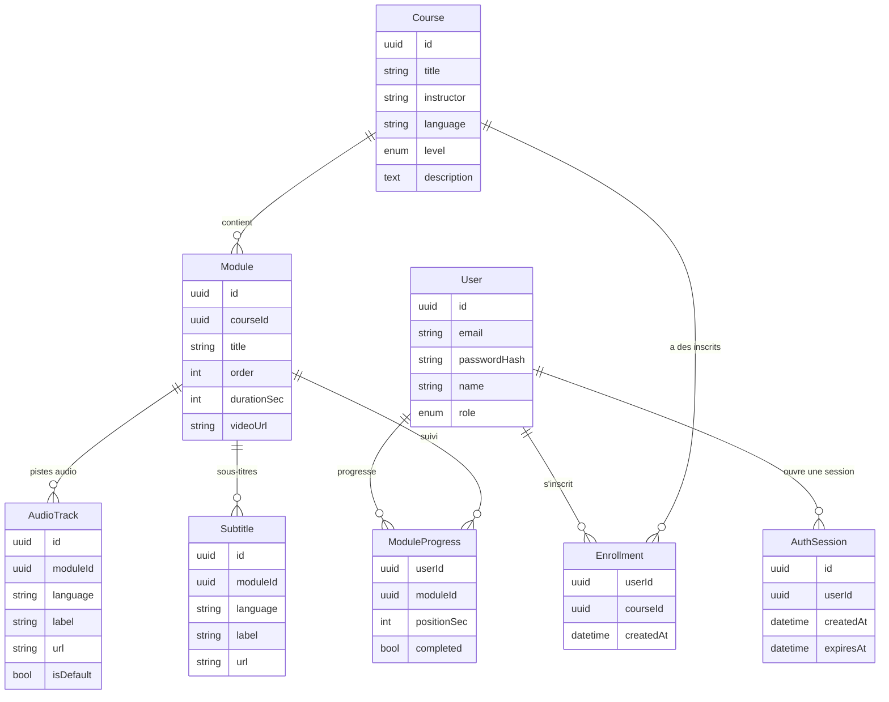

# 2. Conception

## Modèle de données

### Choix de modélisation

- **Progression calculée** : le pourcentage d'une formation = modules terminés / total.
  Pas stocké pour éviter une donnée dupliquée qui pourrait devenir incohérente.
- **`positionSec`** dans `ModuleProgress` : permet de reprendre la lecture où on s'est arrêté.
- **Doublage** : la vidéo est sans piste son ; chaque langue est une `AudioTrack`
  séparée. Ajouter une langue = ajouter une ligne, sans toucher à la vidéo.
- **Clés composites** sur `Enrollment` et `ModuleProgress` : un utilisateur ne peut
  être inscrit qu'une fois à une formation et n'a qu'une progression par module.
- **UUID** plutôt qu'entiers : identifiants non devinables dans les URL.

## API REST (préfixe `/api`)

| Méthode | Route                             | Auth | Rôle                                                           |
| ------- | --------------------------------- | ---- | -------------------------------------------------------------- |
| POST    | /auth/register                    | non  | Inscription                                                    |
| POST    | /auth/login                       | non  | Connexion (pose un cookie httpOnly)                            |
| POST    | /auth/logout                      | oui  | Déconnexion (supprime le cookie)                               |
| GET     | /auth/me                          | oui  | Utilisateur courant                                            |
| GET     | /courses?search=&language=&level= | non  | Catalogue filtré                                               |
| GET     | /courses/:id                      | non  | Détail + liste des modules                                     |
| POST    | /courses/:id/enroll               | oui  | Suivre une formation                                           |
| GET     | /modules/:id                      | oui  | Contenu du module (vidéo, pistes, sous-titres, module suivant) |
| PUT     | /modules/:id/progress             | oui  | Sauvegarder position / marquer terminé                         |
| GET     | /dashboard                        | oui  | Formations suivies + progression                               |

## Pages frontend

`/login`, `/register`, `/courses` (catalogue), `/courses/[id]` (détail),
`/learn/[moduleId]` (lecteur, protégée), `/dashboard` (protégée).

## Administration implémentée

Les pages `/admin`, `/admin/courses/new` et `/admin/courses/[id]` permettent
de gérer les formations et leurs modules. Toutes les routes ci-dessous exigent
une session avec le rôle `ADMIN` et utilisent le préfixe `/api`.

| Méthode | Route | Fonction |
| --- | --- | --- |
| GET | /admin/courses | Liste des formations avec compteurs |
| GET | /admin/courses/:id | Formation et modules avec pistes |
| POST | /admin/courses | Création d’une formation |
| PATCH | /admin/courses/:id | Modification d’une formation |
| DELETE | /admin/courses/:id | Suppression d’une formation |
| POST | /admin/courses/:id/modules | Ajout d’un module |
| PATCH | /admin/modules/:id | Modification d’un module |
| DELETE | /admin/modules/:id | Suppression d’un module |
| GET | /admin/media | Liste des fichiers vidéo, audio et sous-titres |

Les médias sont des fichiers du répertoire `backend/media`, copiés dans l’image
Docker du backend. Les modules et pistes stockent leurs URL locales `/media/...`.
L’import de fichiers est hors périmètre de l’exercice ; aucune route d’import
n’est prévue. Voir le
[guide d’administration](03-administration.md) pour la préparation et l’association
des médias.

## Sessions révocables et documentation interactive

`AuthSession` conserve l’identifiant de session, l’utilisateur et l’expiration.
Le JWT inclut `sid`. Chaque requête authentifiée vérifie cette session en base
et utilise le rôle actuel de l’utilisateur. Le logout supprime la session ;
la suppression du cookie n’est plus le seul mécanisme de déconnexion.

Swagger est exposé sur `/api/docs/`, et OpenAPI sur `/api/docs-json`, sauf si
`SWAGGER_ENABLED=false`. Voir [le fonctionnement et les tests](04-sessions-swagger-tests.md).

## Progression dans le catalogue

`GET /api/courses` reste public. Avec une session valide, chaque formation suivie
contient `learning: { status, completedModules, progress }`. Sinon, `learning`
vaut `null`. Les valeurs de `status` sont `NOT_STARTED`, `IN_PROGRESS` et
`COMPLETED`. Une position sauvegardée positive ou un module terminé marque
le début ; une formation est terminée uniquement si elle possède au moins
un module et que tous ses modules sont terminés.

Les inscriptions et progressions sont récupérées par lots et filtrées par
l’utilisateur authentifié et les formations du résultat. L’API n’accepte pas
d’identifiant utilisateur fourni par le navigateur. La réponse utilise
`Cache-Control: private, no-store` et `Vary: Cookie`. Le frontend recharge
lors des changements de session, de filtres et au retour sur l’onglet.
