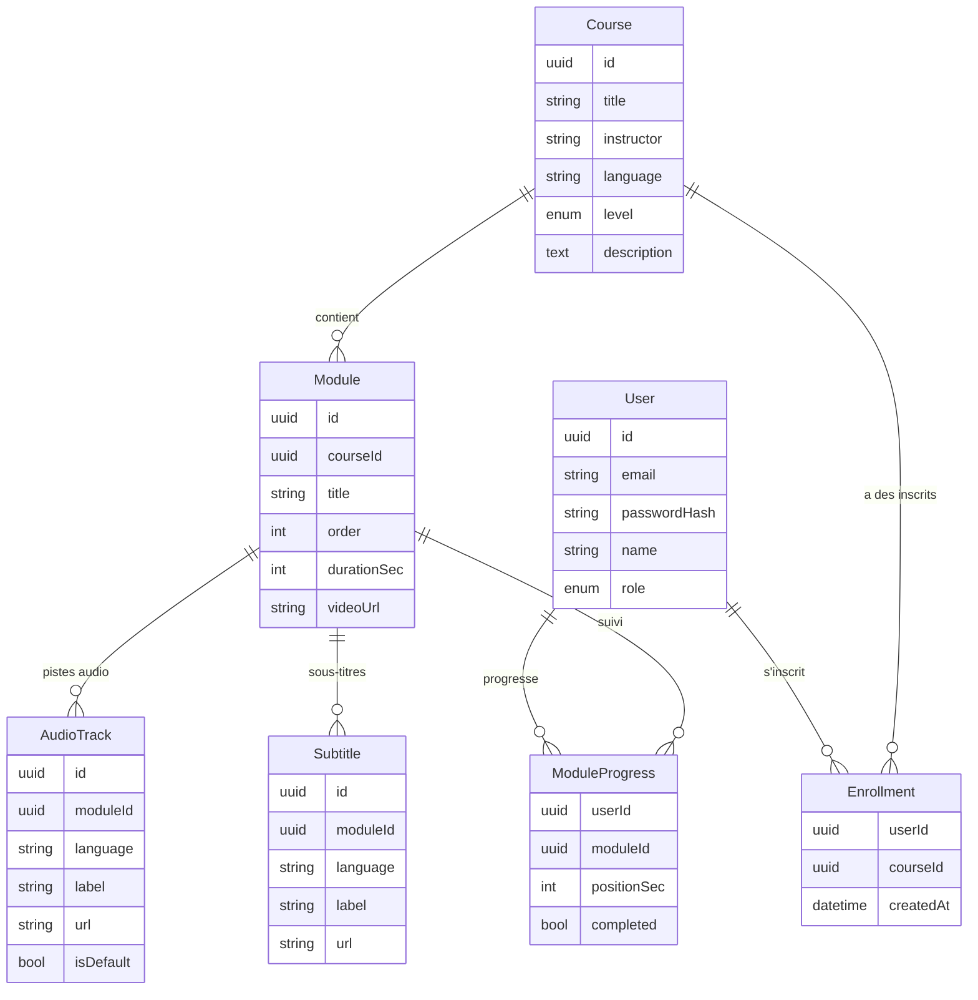

# 2. Conception

## Modèle de données

### Choix de modélisation

- **Progression calculée** : le pourcentage d'une formation = modules terminés / total.
  Pas stocké pour éviter une donnée dupliquée qui pourrait devenir incohérente.
- **`positionSec`** dans `ModuleProgress` : permet de reprendre la lecture où on s'est arrêté.
- **Doublage** : la vidéo est sans piste son ; chaque langue est une `AudioTrack`
  séparée. Ajouter une langue = ajouter une ligne, sans toucher à la vidéo.
- **Clés composites** sur `Enrollment` et `ModuleProgress` : un utilisateur ne peut
  être inscrit qu'une fois à une formation et n'a qu'une progression par module.
- **UUID** plutôt qu'entiers : identifiants non devinables dans les URL.

## API REST (préfixe `/api`)

| Méthode | Route                             | Auth | Rôle                                                           |
| ------- | --------------------------------- | ---- | -------------------------------------------------------------- |
| POST    | /auth/register                    | non  | Inscription                                                    |
| POST    | /auth/login                       | non  | Connexion (pose un cookie httpOnly)                            |
| POST    | /auth/logout                      | oui  | Déconnexion (supprime le cookie)                               |
| GET     | /auth/me                          | oui  | Utilisateur courant                                            |
| GET     | /courses?search=&language=&level= | non  | Catalogue filtré                                               |
| GET     | /courses/:id                      | non  | Détail + liste des modules                                     |
| POST    | /courses/:id/enroll               | oui  | Suivre une formation                                           |
| GET     | /modules/:id                      | oui  | Contenu du module (vidéo, pistes, sous-titres, module suivant) |
| PUT     | /modules/:id/progress             | oui  | Sauvegarder position / marquer terminé                         |
| GET     | /dashboard                        | oui  | Formations suivies + progression                               |

## Pages frontend

`/login`, `/register`, `/courses` (catalogue), `/courses/[id]` (détail),
`/learn/[moduleId]` (lecteur, protégée), `/dashboard` (protégée).
